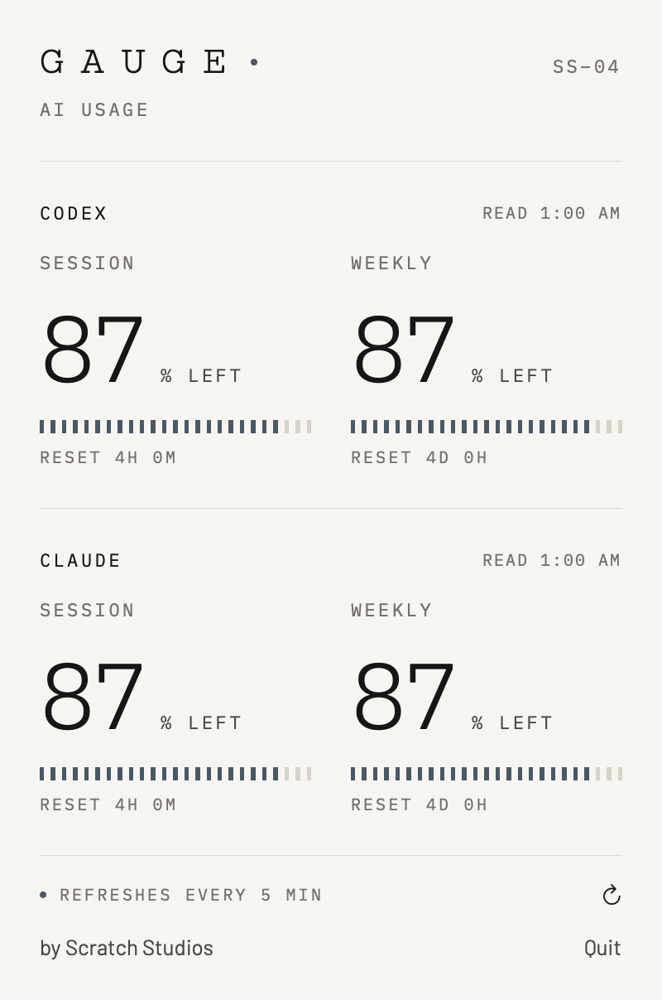
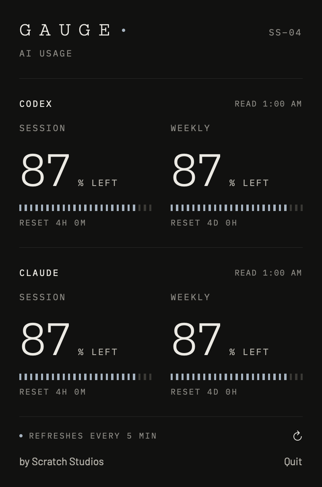
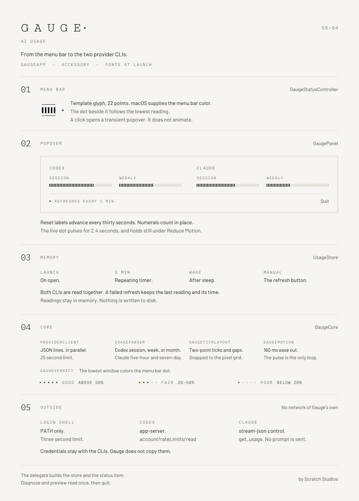

# Gauge

**SS–04 · AI usage · by Scratch Studios**

A quiet read on what remains. Native macOS menu bar readings for Codex and Claude subscription usage.

## Preview

| Paper | Night |
| --- | --- |
|  |  |

## How it works

<picture>
  <source media="(prefers-color-scheme: dark)" srcset="docs/architecture-night.svg">
  
</picture>

The status item, the popover, and the two CLIs it reads.

## Run

Requires macOS 14 or later and Swift 5.9 or later (Xcode Command Line Tools).

```sh
swift run Gauge
```

Build a standalone app:

```sh
bash scripts/build-app.sh
open dist/Gauge.app
```

## Connect providers

Install the Codex and Claude CLIs, then sign in to each one:

```sh
codex login
claude auth login
```

Gauge runs those CLIs as your macOS user and reuses their existing sessions. It never collects, copies, or stores your credentials. When launched from Finder, it reads your login-shell `PATH` and also checks common install locations.

Gauge respects `CODEX_HOME` and `CLAUDE_CONFIG_DIR` when they are in its launch environment. Finder does not inherit custom account variables defined only in your shell startup files.

For each read, Gauge requests Codex rate limits through its app-server interface and Claude usage through its control interface. It sends no user prompt; Claude hooks and tools are disabled. These CLI interfaces are experimental and may change as the providers update their tools.

Readings refresh on startup, every five minutes, after wake, and on manual refresh. If a refresh fails, the previous reading stays visible with a failure notice and its original timestamp. Countdown expiry does not fabricate a refreshed quota. API-key accounts may not report subscription limits.

## Verify

```sh
swift test
swift run Gauge --diagnose
```

The diagnostic command performs real account-usage reads and prints only quota percentages or a status message. No credentials or account identifiers are printed.

The app is distributed locally with ad-hoc signing. Developer ID signing, notarization, launch at login, account selection, and release packaging are future work.

## Design

Uses the generated Swift export from `jforaker/scratch-studios-design` at tag `v1.6.1` (commit `012fa7ae7c05ab04778bed9d2d7da50c9da86412`). Before building a fresh checkout, prepare the sibling repository:

```sh
git clone --branch v1.6.1 https://github.com/jforaker/scratch-studios-design.git ../scratch-studios-design
```

`Sources/Gauge/ScratchTokens.swift` is a relative symlink to `../scratch-studios-design/exports/swift/ScratchTokens.swift`; never edit it in Gauge. The design repo has no `Package.swift`. Barlow, IBM Plex Mono, and Cutive Mono are bundled with their SIL Open Font Licenses. Paper and Night follow the system appearance. Colors use shared tokens, including `gaugeAccent`, `ochre`, `clay`, and `sand`. Verdict cutoffs match the design repo's `quotaThresholds`: above 50% remaining is good, 20–50% fair, below 20% poor. The template menu-bar glyph has a separate live dot reflecting the lowest reading across providers and windows. The wordmark dot stays in the Gauge accent. Existing motion and Reduce Motion behavior are unchanged.

The standalone app icon is built with `iconutil` from the PNGs in `Sources/Gauge/Resources/Icons/gauge.iconset`. Regenerate the menu-bar template images with `swift scripts/render-menubar-icon.swift`.

Render the actual SwiftUI panel in both appearances using live readings:

```sh
swift run Gauge --render-preview
```

Images are written to `.build/gauge-paper.png` and `.build/gauge-night.png`.

For deterministic verification without provider requests, use `--fixture 87`, `--fixture 40`, or `--fixture 10`. Add `--reduce-motion` to opt in to reduced motion without changing the macOS setting. Combine these with `--render-preview` to write Paper/Night captures of the actual SwiftUI popover to `docs/screenshots/`. Without `--render-preview`, fixtures run in the menu bar until quit. The override can only enable reduced motion; it cannot disable the system accessibility preference.
